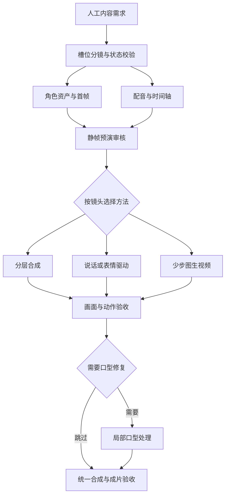

# AI 短剧与短视频生成流水线：架构、选型与实施计划

> 更新日期：2026-11-05｜文档版本：整合版 v1.0  
> 适用环境：audiocc 集群，RTX 4090 / A10（单卡 24GB），调试机 RTX 2080Ti（11GB），无 sudo，通过堡垒机访问。  
> 当前状态：已进行初步搭建尝试与资料调研；新增模型、路由、训练和性能优化尚未在集群验收。项目方数字、原方案估计与实验起点均不等于本集群实测。

本文作为统一实施依据，不再按讨论时间追加互相覆盖的方案。主文描述当前设计与执行顺序，附录 A 保留原链路的部署参考，附录 B 集中列出资料来源。

## 阅读导航

| 目的 | 章节 |
| --- | --- |
| 看当前决策与项目边界 | §1 |
| 理解端到端架构和镜头分工 | §2 |
| 接入 DeepSeek/Qwen 与分镜接口 | §3 |
| 选择模型及推理工具 | §4 |
| 管理生成、音频、口型与合成 | §5 |
| 搭建集群任务和性能优化 | §6 |
| 准备训练数据 | §7 |
| 开展 LoRA、DPO 和 RL | §8 |
| 运行评测并比较成本 | §9 |
| 按阶段推进与记录待决事项 | §10 |
| 查原链路命令和官方资料 | 附录 A、B |

## 1. 目标、边界与当前决策

### 1.1 第一阶段交付

制作一段 **30–60 秒、2 个角色、1 个场景**的中文短剧小样。人工提供故事需求、角色关系、关键情节、目标风格与必须保留的台词；语言模型把需求拆为受约束镜头，生成系统负责执行与验收。

评估目标是角色可辨、台词完整、动作表达清楚、镜头连续且成本可接受。整集由短镜头剪辑完成，不要求一次生成完整短剧。Wan 默认约 5 秒的片段长度是当前配置，不是台词和成片的硬上限。

### 1.2 当前决策表

| 状态 | 决策 | 执行含义 |
| --- | --- | --- |
| 采用 | 槽位策划 + 角色/场景资产 + 镜头路由 | 不让视频模型承担整集故事理解与全部画面生成 |
| 保留基线 | CosyVoice2 + Wan2.2 TI2V-5B + 必要口型处理 | 保留已有工作，用于对照和回退 |
| 优先验证 | Wan 5B Turbo、HunyuanVideo-1.5 480p 蒸馏版 | 选择普通动作镜头的高效后端 |
| 优先验证 | EchoMimicV3-Flash、MuseTalk；需要时配 LivePortrait | 降低说话/反应镜头成本 |
| 待比较 | 有限动画漫剧、真人对话近景 | 用同需求、同预算样片决定产品路线 |
| 按需开展 | VACE、FramePack、InfiniteTalk、LTX、EdenLive | 仅为明确的结构控制、长镜头或音画需求立专项 |
| 后置 | 视频 LoRA → DPO → 在线 RL | 先固定后端、建立基线，再处理重复出现的缺陷 |

### 1.3 风格选择原则

| 路线 | 优势 | 主要难点 | 本阶段定位 |
| --- | --- | --- | --- |
| 真人对话近景 | 可沿用现有音频和口型链路 | 身份、牙齿、皮肤和细微表情容错低 | 基线候选 |
| 2D 有限动画漫剧 | 立绘/背景复用，合成可承担较多时长 | 线条、比例稳定，嘴型与驱动适配 | 成本优先候选 |
| 完整 2D 动漫 | 美术可由设定图控制 | 大动作、透视、运动节奏与线条连续 | 暂不作为 MVP |
| 3D 卡通 | 自建资产能提供强条件 | 几何、接触、材质与身体运动 | 有资产时再考虑 |

“有限动画容易制作”是减少生成量的工程判断，不是动漫底模天然强于写实的结论。将东亚外观、摄影风格和动漫画风分开定义；不根据少量输出断言底模只能生成欧美写实。

## 2. 整体架构与镜头路由

### 2.1 端到端流程



### 2.2 路由规则

| 镜头类型 | 首选方法 | 升级或回退 |
| --- | --- | --- |
| 空镜、静物、过场 | 图像 + 平移缩放/分层合成 | 需要真实运动时用少步 I2V |
| 漫剧简单对话 | 立绘 + 嘴型/眨眼/局部动作 | 目标画风验证过的角色驱动 |
| 真人头肩对话 | EchoMimic；或 LivePortrait + MuseTalk | 原 I2V + 口型处理 |
| 倾听、点头、反应 | 驱动模板或表情合成，无口型 | 少步 I2V |
| 单人普通动作 | Wan Turbo / Hunyuan 测试优胜配置 | 原 Wan 质量配置 |
| 精确姿态/走位 | 代理视频 + VACE 类条件控制 | 人工关键帧或拆镜头 |
| 必须持续的长镜头 | 历史条件/分块生成专项 | 优先评估可否通过剪辑完成 |

第一版只允许一个主要动作和一个简单运镜，双人对话优先正反打。普通镜头先生成一条，失败再补种子；重点镜头才预先生成多候选。原生音频驱动输出若已通过口型验收，不再无条件执行 LatentSync。

### 2.3 资产与控制层

角色库保存身份设定、服装、多角度参考、表情、音色和必要的分层前景；场景库保存背景、光线、布局与固定道具；动作库保存可授权复用的驱动视频/模板及适用视角和景别。

首帧必须先通过身份、构图、服装、道具、视线和背景审核。参考正确后再生成运动。精确动作可由摄像头录制或简单骨骼/3D 预演提供条件；只有所选后端支持该条件时才启用。字幕和文字尽量后期叠加。

## 3. DeepSeek / Qwen 策划层与数据契约

### 3.1 人、模型与程序分工

- 人工：内容需求、角色资产、剧情与风格审核、最终选片。
- 文本模型：故事节拍、台词草稿、镜头拆分和槽位填写。默认一个模型生成，另一模型只复核困难样例。
- 视觉模型：仅在额度包含相应图像/视频输入能力时，用于首帧检查、标注和缺陷定位；文本模型不能只凭文件名验画面。
- 本地程序：JSON Schema/Pydantic 校验、资源引用、动作白名单、时长、连续性状态、路由与任务提交。

DeepSeek JSON mode 的 response_format 使用 json_object，提示词中明确 JSON 和示例；Qwen 按额度实际支持的模型/模式选择结构化输出。即使服务端支持 Schema，本地仍校验业务约束。仅从环境变量读取 key，记录模型、prompt/schema 版本、token 用量及重试原因。模型输出不作为任意 shell 命令执行。

### 3.2 两层规划

剧集层保存主题、角色/场景库、总时长预算、剧情节拍和完整音轨。镜头层引用已有资产，只描述局部变化。程序维护服装、道具归属、站位、视线、光线和进入/退出状态，禁止无依据改写。

时间轴先于最终生成配置：TTS 实测音频长度后安排镜头，程序再计算后端允许的尺寸、帧数和裁剪。不同后端的帧数约束不共用。

### 3.3 镜头接口示例

```json
{
  "schema_version": "1.1",
  "shot_id": "s003",
  "template_id": "single_reaction_closeup",
  "render_method": "portrait_drive",
  "backend_profile_id": "reaction_profile_candidate",
  "style_id": "limited_anime_v1",
  "scene_id": "cafe_day_01",
  "character_id": "role_A",
  "costume_id": "A_costume_01",
  "reference_asset_id": "A_cafe_front_01",
  "motion_asset_id": "slight_head_turn_01",
  "framing": "medium_closeup",
  "camera": "locked",
  "primary_action": "turn_head_slightly",
  "emotion_start": "neutral",
  "emotion_end": "surprised",
  "gaze_target": "role_B_offscreen_right",
  "line_id": null,
  "audio_mode": "offscreen_dialogue",
  "target_duration_s": 3.0,
  "state_in_id": "state_002",
  "state_out_id": "state_003",
  "lip_sync": false
}
```

这是待实现的设计示例，其中资源/profile ID 必须在实际注册表存在并经过画风适配验收。generation_frames、fps、steps 等由后端配置解析后写入执行记录，不由语言模型自由填写。原有 shot/role/line/prompt/first_frame 简单接口通过转换器映射，避免两个格式长期并存。

校验失败最多自动修复 2 次，之后人工处理。未知资源 ID 不得臆造；能力目录只登记实际验收过的组合。动作超限优先拆镜头，不靠堆叠提示词解决。

---

## 4. 模型选择与推理后端

### 4.1 普通短镜头与首帧

| 候选 | 官方已公开的能力/配置 | 在本集群的定位 | 关键限制及下一步 |
| --- | --- | --- | --- |
| Wan2.2 TI2V-5B 原版 | 已有 T2V/I2V 链路 | 保留基线和当前微调起点 | 原方案速度仍需逐卡复测；5 秒是默认配置 |
| Wan2.2 TI2V-5B Turbo | 作者提供 4 步、无 CFG、121 帧/24fps、1280×704 I2V [R01] | 第一优先快速候选 | 是作者发布的派生蒸馏版，并非把原采样器改 4 步；评估表情、动作、多样性、LoRA 兼容和 offload |
| HunyuanVideo-1.5 | 8.3B；官方 480p I2V step-distill 推荐 8/12 步；offload 最低显存口径 14GB [R02] | 第二优先跨模型候选 | 模型更大但少步可能更经济；新建环境，匹配权重、采样器与文本编码器；A10/4090 分别测 |
| LTX-Video 2B 0.9.8 distilled | 旧版小模型，I2V/多条件和相关工作流；官方列出低显存版本 [R03] | 低成本预演/空镜候选，非默认成片主力 | 仓库已标 legacy；2B 不能继承 13B 的全部长时宣传；与 LTX-2.x 分开管理 |
| Wan2.1 T2V-1.3B | 官方给出 8.19GB、4090 生成 5 秒 480p 约 4 分钟的参考 [R04] | 小模型工程检查或研究基线 | 此条对应 T2V，不应当作现成固定角色 I2V；低参数并不自动比 5B Turbo 快 |
| FLUX.2 klein 4B 图像模型 | 官方约 13GB，支持生成/编辑/多参考；4B 与 base 为 Apache 2.0 [R05] | 补全原方案缺失的角色首帧/改景能力 | 图像模型，不输出视频；参考人物保持与动漫适配仍需测试，图像 base/蒸馏版分开选择 |
| Z-Image-Turbo 图像模型 | 6B、8 NFEs、官方称可在 16GB 设备运行 [R06] | 首帧/背景快速生成备选 | 不把未发布的 Edit/Omni 功能算入能力；角色多参考不是 Turbo 的默认保证；H800 亚秒速度不能套用 4090 |

建议第一轮只部署 Wan Turbo、Hunyuan 1.5、一个首帧候选，不同时下载表中全部权重。已有稳定图像模型时先复用。若目标明确为二次元且现有动漫图像模型已满足需求，可继续使用，但必须确认其权重、适配器与使用条件；不因追新重做资产库。

### 4.2 说话与角色驱动

| 候选 | 已确认功能或项目方数字 | 推荐镜头 | 边界 |
| --- | --- | --- | --- |
| MuseTalk 1.5 [R07] | 局部口型生成，支持头像预处理缓存；官方记录 fp16 4GB 设备示例、V100 30fps+ | 已有身体运动的视频、固定说话头像 | 4GB 示例为 Windows 且生成 8 秒约 5 分钟；实时数字含特定条件，不能当全部端到端速度；小脸/大侧脸/动漫须验证 |
| LivePortrait [R08] | 参考图/视频 + 驱动视频或动作模板，支持表情与头部运动 | 单人头肩、倾听、点头、反应镜头 | 不是原生音频驱动；不能仅输入 wav 就得到同步嘴型；强调头部而非复杂躯干动作 |
| EchoMimicV3-Flash [R09] | 1.3B 系、8 步；官方说明约 12GB、最高 768×768、无需 face mask；有中文音频示例 | 参考图 + 音频的单人表演 | 12GB 仍超过 2080Ti 11GB；方形上限不等于已验证任意竖屏；表演和长时质量需实测 |
| Ditto [R10] | 音频驱动的运动空间扩散，提供 TensorRT/PyTorch 路径 | 快速头像/长台词预演 | 默认 TRT 包为 Ampere_Plus；2080Ti 需另行转换或测试 PyTorch；头部实时不等于全身电影镜头 |
| InfiniteTalk [R11] | 基于 Wan2.1 I2V-14B；流式说话视频，含低显存选项及 4–8 步加速入口 | 需要身体联动或更长对话时的备选 | 底模仍重；low-VRAM 标志不保证本配置时延；“无限”指分块机制，不保证无限无漂移 |
| LatentSync 1.5/1.6 [R12] | 官方最低推理显存分别 8/18GB | 已有视频的口型修复/质量回退 | 1.5 与 1.6 分辨率配置要匹配；有动漫演示，不等于任意画风通用；口型前后都测身份与牙齿质量 |

设计两条便宜支路：有动作库时用 LivePortrait → 必要时 MuseTalk；没有可用驱动但有音频时测试 EchoMimicV3-Flash。不要无条件串接全部模型：重复修改脸部会引入新的失真。原生音频驱动结果通过口型验收后，直接合成，无须再跑 LatentSync。

### 4.3 长时、结构控制与新一代音画联合

| 候选 | 已确认事实 | 采用建议 |
| --- | --- | --- |
| FramePack [R13] | 官方称 13B 可用 6GB 做 60 秒/30fps；4090 参考约 1.5 秒/帧（TeaCache）或 2.5 秒/帧（未优化） | 低显存长镜头研究，不作为默认快生成器；按项目数字推算一分钟约 45–75 分钟，仅为算术估算，不是本集群测试 |
| VACE-Wan2.1-1.3B / 14B [R14] | 支持参考、姿态/深度等视频条件和局部编辑；1.3B 可做结构控制实验 | 测试简单代理动作 → 目标角色重绘；保留低模型容量带来的质量限制。用户指南明确长素材会截取/采样，不能当任意长视频编辑器 |
| Self Forcing [R15] | 项目报告优化后 4090 约 10fps 的 480p 流式生成；也明确超训练时域后会退化 | 理解短低延迟与长时稳定的差异；T2V 研究结果不直接等价当前 I2V 生产能力 |
| LongCat-Video [R16] | 13.6B，原生含 Video-Continuation 训练任务 | 有持续长镜头需求时再比较；先证实 24GB 路径，不以分钟级演示推断成本 |
| LTX-2.5 [R17] | 当前官方推荐系列，支持多种音画/关键帧工作流；官方 Python 系统页列最低 32GB+ | 功能强但非当前单卡 24GB 的无条件替代；若测量化/offload 则独立环境、降低预算、单独记录。联合音频生成不保证固定角色中文音色/指定台词 |
| EdenLive Wan2.2 5B [R18] | LightX2V 已提供代理录制 + 首帧 + 文本的自回归重绘入口 | 很符合“人提供表演，模型负责外观”的方向；已公开实时配置依赖 RTX5090/SM120 等条件，不能照搬到 4090/A10；列为专项探索 |

LTX 的官方桌面工具与 Python 路径出现 24GB+、32GB+ 不同口径，必须绑定到具体软件/量化/解码器，而不是挑最低值填资源表。新版本的不同 VAE、文本编码器与适配器不可随意混用。

### 4.4 后端的角色

| 工具 | 建议用途 | 约束 |
| --- | --- | --- |
| LightX2V [R19] | 同模型性能优化；已提供 TI2V-5B 和 4090 offload 配置 | 先对齐原模型采样、帧数与输出，后测优化；A14B 蒸馏 LoRA 不可加载给 5B；每个模型支持项分别核对 |
| WanGP / 原 Wan2GP [R20] | 低显存探索、快速试模型和生成配置 | 低显存是特定模型/配置结果，不给整个模型列表保证；预载、CPU RAM、Sage 内核要求需检查 |
| ComfyUI | 人工探索参考图、控制和工作流 | 保存 API 格式工作流、锁定节点 commit；后续通过 worker 适配调用，不能把可视化界面当作批处理可靠性证明 |
| 原生 CLI / Diffusers | 可复现的基线与最小生产适配 | 功能覆盖与内存优化依具体版本，不保证同名 pipeline 质量完全相同 |

---

## 5. 视频生成、音频与成片流程

### 5.1 正式生成顺序

1. 确定角色/场景与内容需求，生成并校验槽位分镜。
2. 配音并读取真实时长，与首帧组成带音频静帧预演（animatic）。
3. 人工审核节奏与剧情后，按镜头路由生成；没有动作必要的镜头直接合成。
4. 验收画面、身份和动作，仅对入选且需要的镜头处理口型。
5. 超分、补帧等高成本操作放在候选选择后，最后统一编码与合成。
6. 验收完整台词、跨镜头状态、字幕、音量和编码，形成可用成片。

### 5.2 时长与音频规则

- 121 帧/24fps 约 5 秒是当前 Wan 默认；长台词可跨反应镜头、空镜和正反打，不必逐句硬拆。
- 说话近景的视频必须覆盖其音频切片与必要停顿，不切断音素。`-shortest` 只用于覆盖确认后的收尾，不能代替时长规划。
- 保留 TTS 原始高质量 master；16kHz 等副本供模型输入，成片回用 master 并核查偏移。固定角色参考音及其准确转写；先验收音色与情绪，不为音频已失败的镜头生成视频。
- 仅必要支路进行 24/25fps 等转换；保持播放时长，不通过改解释帧率拖长视频。最终统一一次交付 fps。
- 补帧不创造缺失的剧情动作，超分不修复身份漂移；嘴部、快速运动和遮挡必须复查。
- `concat -c copy` 仅适用于尺寸、编码、fps、时间基等兼容且时间戳正确的素材；异构输出先统一重编码。

### 5.3 长镜头与连续性

优先用剪辑讲完整故事。尾帧接力可做续写基线，但会累积角色和构图漂移；关键镜头重新锚定角色资产。持续长镜头需要历史条件、分块误差和跨块状态的专项评估，普通风格 LoRA 或 RL 不自动带来长时记忆。

### 5.4 质量关卡与局部重试

| 关卡 | 检查 | 失败动作 |
| --- | --- | --- |
| 首帧 | 身份、构图、服装、背景、视线 | 重做/编辑首帧 |
| 动态 | 动作完成、时间稳定、主体身份 | 简化动作、换模板或后端 |
| 口型 | 同步、牙齿、口部及周边身份 | 仅重跑口型，必要时换支路 |
| 连续性 | 站位、道具、光线、台词覆盖 | 重排时间轴或修正相关镜头 |
| 成片 | 台词、音量、字幕、编码 | 仅重做合成 |

保留所有候选及失败原因，为评估和偏好数据服务；不覆盖被淘汰样本。动漫检测和相似度指标必须先验证，不能直接用真人分数做验收。

---

## 6. 集群部署、调度与性能优化

### 6.1 最小架构

单个轻量协调进程 + JSON 任务清单 + 集群现有提交脚本 + 每类模型的 worker 适配层。先不引入 Kubernetes、Ray、复杂分布式数据库；除非任务规模证明必要。调度器类型未知，接入已有提交脚本即可，不预设 Slurm。

依赖关系：策划/资产/音频可在各自依赖满足后并行，镜头生成独立，入选后再口型，最终剪辑汇合。每个任务记录 pending/running/succeeded/failed、输入哈希、依赖、申请资源、重试原因、产物路径和验收记录。输出写临时路径，通过完整性检查后原子 rename；中断后只重做缺失节点。

### 6.2 减少模型加载浪费

在一次集群作业分配内，worker 加载某一模型后连续处理相同配置的镜头队列；不要每 5 秒镜头都重新启动环境、加载几十 GB 权重。不是永远霸占 GPU 的服务：运行时间和驻留范围仍服从集群配额。

按模型、分辨率、帧数分桶，先保持每卡一个重任务；轻模型并发也要经过峰值测量。常驻 GPU 模型不共享给不相关进程。TTS、口型与生成采用各自环境和进程，通过产物与契约连接，不要求一个 Python 环境装下所有模型。

共享目录保存权威资产与结果；节点本地 SSD（若存在且允许）缓存权重和临时帧，结束时回传必要结果。缓存按模型 hash 管理并设置容量与清理策略；不把数十万 PNG 长期写进家目录。

### 6.3 可复现契约

每个后端至少接收统一的 shot_id、asset_ids、prompt、seed、target_duration、output_path，并声明 capabilities。后端自己转换为模型专属帧数/尺寸/采样参数；不把 Wan 的 4n+1 约束套到 LTX 的 8n+1 上。

保存 model revision/hash、code commit、环境锁定、GPU 型号、dtype、quant、attention、scheduler、steps、offload、VAE、完整首帧/音频哈希和原始输出。首帧、视频、口型、合成各有独立缓存键；输入变化后只失效下游节点。

OOM 的处理：标记失败配置→卸载/重启该 worker→使用事先批准的较小预算配置重试一次；不无限重试。必要时把 job 路由回质量基线，不能悄悄删台词或降帧率拖长视频。

### 6.4 任务状态与失败恢复

执行记录使用 pending、running、succeeded、failed，并将“产物生成成功”与“质量验收通过”分别记录。验收规则统一见 §5.4；被淘汰的候选保留原因和文件，不误标为可用镜头。

输入或配置变化只使下游节点失效；重复提交先查缓存与状态。运行中断从最后一个已确认产物恢复；格式修复、OOM 和质量重抽分别设置有限重试预算。超过预算返回人工处理，不通过删台词或延长播放解释伪造成功。

### 6.5 硬件分工与目录

| 资源 | 默认承担 | 边界 |
| --- | --- | --- |
| 2080Ti 11GB | 下载、预处理、ffmpeg、兼容的 FP16 TTS/口型测试 | 不作为默认 Wan 720p 与 LatentSync 1.6 节点；其他低显存实现单独测试 |
| 4090 24GB | 首轮生成基准、兼容的量化/加速、LoRA 试跑 | 留出 VAE/激活峰值；推理能跑不代表训练能跑 |
| A10 24GB | 独立复测后承担同类任务 | 同显存不代表与 4090 同速度/内核支持 |
| CPU / 共享存储 | 策划协调、清单、音轨、权威资产与结果 | offload 要计入 RAM 和 IO 配额 |

```bash
export WORK=/exp/yi.yang/shortdrama
mkdir -p "$WORK"/{models,repos,configs,logs,cache,datasets}
mkdir -p "$WORK"/project/{scripts,assets,voice_ref,tts_out,shots,synced,final,manifests}
```

沿用已有 voice_ref、tts_out、shots、synced、final 路径，新增 assets/manifests/configs。家目录仅放小配置，模型与中间产物放大容量目录；原链路至少按约 100GB 起步核算，多模型/数据集按真实文件另算。缓存须设限。未知的集群提交接口、CPU RAM 和本地 SSD 条件在实施前记录，不自行假设。


### 6.6 加速方法与验证顺序

| 方法 | 主要收益 | 必须验证 |
| --- | --- | --- |
| 资产复用/专用驱动 | 避免整幅视频生成 | 风格、表演和画面丰富度能否达标 |
| 少步/CFG 蒸馏 | 降低网络调用次数 | 匹配 checkpoint、scheduler、timestep 和 CFG 设置；表情及动作质量 |
| FP8/INT8/GGUF 等 | 减小权重内存/搬运量 | 内核、GPU 架构、精度退化、LoRA 加载方式 |
| CPU/block offload | 降峰值显存 | CPU RAM、锁页内存、PCIe 带宽、层搬运与吞吐 |
| 注意力内核 | 降注意力耗时/内存 | 4090/A10/2080Ti 各自支持性；相同输出质量 |
| TeaCache/DeepCache 等 | 复用中间计算 | 闪烁、动作丢失、身份、色彩退化；不能视为无损 |
| VAE slicing/tiling/轻量解码器 | 降解码峰值、加快预览 | 接缝、闪烁、颜色、最终画质；预览解码器不直接替代最终解码 |
| torch.compile/CUDA Graph | 固定形状多次生成可摊销 | 编译时间与额外显存；与 offload/可变尺寸兼容 |
| 低分辨率预演→入选重生成/超分 | 降低探索预算 | 低分辨率好种子不保证高分辨率仍好；跨模型同 seed 更不等价 |

硬件与兼容性规则：

- 4090（Ada）优先用于视频生成与兼容的 FP8 kernel；A10（Ampere）先测 BF16/FP16 + offload/INT8 等实际可用路径。权重以 FP8 存储与硬件原生 FP8 计算是两回事。
- 2080Ti（Turing）以 FP16、CPU/轻任务和兼容口型支路为主；不能直接运行 BF16、Blackwell NVFP4 或预编译 Ampere_Plus 引擎。低 VRAM 文档不等于支持其计算架构。
- 量化收益不能套用 5090 的 SM120/NVFP4 数字；Flash/Sage 版本也不只由“显存够不够”决定。
- 把 cache、量化、蒸馏、compile 分开做消融，一次只加一项；保留一个保守质量配置。

建议顺序：原版 warm baseline → 少步模型 → 分组/阶段 offload → 合适注意力内核 → 量化 → cache → compile。实际顺序可按瓶颈调整；先分析加载/文本编码/去噪/VAE 的分项耗时，不盲目优化最显眼环节。

---

## 7. 训练数据：来源、清洗与标注

### 7.1 来源优先级

| 来源 | 适用目标 | 获取与验收 |
| --- | --- | --- |
| 自摄或授权演员素材 | 真人微表情、转头、对话 | 固定机位录制目标动作，多角度/人物；确认训练和使用授权 |
| 自有/授权角色的动画或渲染 | 有限动画、姿态与表情控制 | 立绘/骨骼/3D 渲染动作变体，导出姿态与角色 ID；避免全是僵硬循环 |
| OpenHumanVid | 人体动作与表演候选池 | 从项目实际开放条目中筛选；先核查可下载内容和使用条件 |
| OpenVid-1M | 通用运动和镜头候选池 | 按画风、主体、景别和动作筛选后重新标注；不整库盲训 |
| 当前模型生成的优劣候选 | 偏好数据、成功镜头蒸馏 | 记录条件和种子，人工检查动态与身份；不能补出底模从未会过的动作 |

开放数据集不是天然的目标动漫数据集；元数据可获取也不保证底层视频可下载或允许目标用途。逐条记录 source_url、license/授权记录、原始 source_id、处理版本与允许用途。影视/动漫剪辑不能仅因网上可见就直接作为可复用训练集。涉及商业用途时以实际条目授权为准，本文不替代许可核实。

### 7.2 第一批样本预算（实验起点，非成功保证）

- 图像角色/风格适配：每个固定角色先整理约 30–100 张多角度、多表情图；风格适配另需多人物、多背景，避免风格绑定到一个人。
- 视频动作 LoRA：先做 100–200 条人工验收的小集合验证训练实现，再扩至 500–2,000 条；聚焦少数动作，不同时追求所有类型。
- 偏好学习：积累同一首帧、同一提示条件下的候选组，先标 200–500 对用于验证偏好一致性与训练流程，再根据验证集收益增加。

样本量不能取代覆盖设计；重复相邻片段不算独立样本。真实与动漫分别建域，单独训练、单独评估。

### 7.3 清洗与标注流程

1. 分镜切割，剔除跨切镜、片头、转场；保留原始帧率及时间戳。
2. 筛选 2–5 秒单镜头、主体清晰、目标画风匹配的片段；去重在数据集切分前完成。
3. 检查字幕/水印、模糊、压缩、畸形及运动质量；不把带字幕或口型损坏的数据大量用于视觉微调。
4. 训练/验证/测试按原视频、人物或场景分组拆分（可从 80/10/10 起步），禁止同一来源的邻近片段跨集合。
5. 视觉模型看视频或按时间抽帧进行初标，再人工验收。稀疏抽帧只用于粗筛，不能可靠证明动作顺序和口型。
6. 标注实际可见内容：外观、场景、景别、起止状态、动作顺序、相机运动。台词/音频是另一个字段；无声 I2V 训练不因字幕里写了台词就获得音频条件能力。
7. 缓存视频 latent、文本 embedding 和首帧条件时，保存模型/预处理版本，且保持 I2V 首帧条件与视频一致。

示例清单字段：clip_id、source_id、source_url、rights_record、style_id、character_id、scene_id、start_s、end_s、fps、width、height、caption、action、emotion、camera、split、review_status。偏好表另含条件哈希、winner_id、loser_id、reason、问题时间段和标注者。

---

## 8. 微调、偏好优化与 RL

### 8.1 分开外观与运动实验

1. 基线：冻结现有模型，使用统一角色首帧和槽位分镜。
2. 图像适配：若外观问题仍在，先训练兼容所选图像模型的角色/风格 LoRA；其权重不能直接加载到视频模型。
3. 视频适配：首帧正确但动作/风格保持差时，在已选定后端上训练 I2V LoRA；以当前 TI2V-5B 基线为例，冻结文本编码器与 VAE，以 flow matching 监督目标更新视频 DiT 的 LoRA。
4. 偏好优化：在 C 的基础上进行视频/flow 兼容 DPO；普通 LLM token DPO 不能直接套用。
5. 在线 RL：只针对仍未解决、可验证的动作目标试验；不作为第一轮训练。

角色和风格 LoRA 起初分别验证；叠加可能相互干扰，必须测试组合权重。视频 LoRA 不负责理解整集剧情，也不会自动获得长时记忆。

### 8.2 24GB 卡的训练试跑

使用 DiffSynth-Studio 提供的 Wan2.2-TI2V-5B I2V LoRA 示例作为起点，锁定 commit、模型版本和依赖，不照搬未验证的社区命令。官方示例含 input_image 条件、rank 32 及 attention/FFN 模块，但不是单卡 24GB 的显存保证。

| 配置 | 第一轮起点 | 调整依据 |
| --- | --- | --- |
| 分辨率 | 约 480p 且满足 VAE/patch 尺寸约束，保留目标横竖构图 | OOM 时降低面积，不拉伸人脸 |
| 帧数 | 先 49，后验证 73/121 | 先让短动作可学，再扩大时域 |
| LoRA rank | 16，必要时比较 32 | 看留出集，不按训练 loss 单独决定 |
| 学习率 | 先 5e-5；失败时比较 1e-5/1e-4 | 固定其余变量，检查过拟合/欠拟合 |
| batch | 每卡 1，累积到有效 batch 4–8 | 实测稳定性和吞吐 |
| 精度/省显存 | 支持时 BF16、梯度检查点、文本/latent 缓存 | 量化训练仅在框架明确支持时使用 |
| 验证 | 每 100–200 个更新步，同一组条件及种子 | 比较动作、身份和非目标能力退化 |

先用 8–16 条片段做小数据过拟合检查，确认数据、首帧条件、loss 和权重加载正确，再训练正式数据。第一轮 50–100 步只测显存、吞吐和数值稳定；不要将其当作最终质量结论。记录峰值显存、CPU RAM、磁盘缓存、每步耗时、更新步数和验证结果。按实测每步成本估算完整训练，不承诺固定训练小时数。

LoRA 节省可训练参数/优化器内存，但视频激活仍大；DDP 每卡复制模型，不能拼显存。单卡仍无法容纳时，先缩小面积/帧数和启用缓存、检查点，再评估 offload/FSDP 等分片；4090/A10 的互联和 CPU/IO 会影响收益。训练进程不与生成任务挤同一卡，2080Ti 主要承担预处理和轻量验证。

### 8.3 停止与选择标准

训练 loss 下降不等于短剧更好。每个 checkpoint 在独立的未见角色/场景/动作组合上，与冻结基线盲评。若同样预算下镜头可用率无改善，或身份/动作多样性退化，停止扩训练、回查数据与条件。不用验证集反复挑选后再把同一批当最终测试。

### 8.4 偏好优化与奖励设计

先让评分器为已有候选排序，确认与人工判断一致，再让它指导训练。单独报告身份、动作完成、闪烁、风格和可用率，避免一个总分掩盖问题。动漫使用目标域验证过的特征/人工评分，不直接把真人识别分数当可靠身份奖励。

- DPO：同条件比较胜负，记录具体缺陷和时间段。保留动作幅度与完成约束，避免总选“少动但干净”的片段。可参考 VideoDPO、DenseDPO 的设计，但须适配 flow 模型和当前实现。
- 在线 RL：参考 DanceGRPO/面向 I2V 的 TAGRPO。需要处理随机采样、轨迹概率、参考约束与奖励，不是换个 loss 开关。官方代码支持的模型版本须逐项核对。
- 节约预算：先 LoRA、短片段和低分辨率，rollout、评分和更新分阶段调度；小候选组可用于工程试跑，算法正式组大小按实现和验证决定。
- 防止投机：保持身份的同时要求指定动作完成；奖励过度平滑或静止均不能视为成功。保留参考约束/SFT 回放与独立人评，评估多样性。
- 策划层先优化：镜头模板、提示词和候选筛选可先用普通搜索/统计迭代，不必先对语言模型或视频模型做 RL。API 额度不等于可获得模型权重训练权限。

### 8.5 选型与蒸馏兼容性

1. 区分 base 模型 LoRA 与少步模型 LoRA：加载成功不等于保留蒸馏性能；必须在生产用 steps/CFG/scheduler 上验收。若在 base 上微调，评估是否需重新蒸馏；不默认原 Turbo 与任意 LoRA 可组合。
2. 首帧、口型、动作三个数据集分开管理。例如口型要准确音画配对，普通无声 I2V 数据不能替代；泛化短剧动作也不应只用正脸讲话数据。
3. 只有后端稳定且特定失败反复出现，才按 §7–8 收集针对性数据。保留跨底模通用的资产/片段与标注，latent 缓存则绑定模型版本。
4. LatentSync 官方提供约 20GB 的 efficient Stage2 训练入口，512 Stage2 训练显存口径约 55GB [R12]；因此 1.6 推理可跑不意味着其 512 训练可直接在 24GB 卡做。若问题集中在口型，可以先验证适配的小模型/低分辨率支路，而非训练视频底模。
5. 蒸馏的教师生成与 rollout 也有成本；例如 Wan Turbo 作者的原训练报告使用 16 张 A100、约 48 小时 [R01]。本集群先复用公开权重，不把“4 步推理”误解为“4 步蒸馏很便宜”。
6. RL 放在有明确奖励、人评验证与基础能力之后。便宜生成器有助于采样，但如果目标只剩固定头部/嘴型动作，专用驱动和监督微调可能更直接。

---

## 9. 评测设计与成本口径

### 9.1 先筛资源可行性，再扩大质量对比

先做资源可行性筛选，再展开风格与质量对照；不另重复一套 72 条风格测试。根据候选是否通过前一级验收，逐步扩大预算。

| 级别 | 输入与预算 | 输出 |
| --- | --- | --- |
| T0 资源冒烟 | 每候选 1–2 条，先 4090；通过后 A10；只部署优先候选 | OOM/依赖/实际显存、RAM、冷启动与热运行时间 |
| T1 普通 I2V | 6 个镜头×2 种风格×2 种子×3 后端：原 Wan、Wan Turbo、Hunyuan，共 72 条；资源有限时先单风格 36 条 | 单主体动作、表情、静态环境、目标画风与成本 |
| T2 对话 | 4 段中文音频（含短句、较长句、停顿、情绪）×2 风格×3 支路：原链、LivePortrait+MuseTalk、EchoMimic，共 24 个输出 | 同一参考资产下的同步、表演、身份与成本；不支持某风格标 N/A 而非无限重试 |
| T3 完整成片 | 两个入围路线各做同一 30–60 秒剧本 | 全链成本、修改时间、连续性、观感盲评 |
| T4 专项 | 仅有明确需求时选 FramePack/VACE/InfiniteTalk/LTX/EdenLive 之一 | 单一问题的收益证明 |

同模型比较固定种子与全部条件；跨模型共用语义/参考资产和输出要求，但同一个数字 seed 不代表同噪声或同质量机会。原生支持分辨率不同要分两张表：同交付规格的端到端成本、各自原生质量。不要把 480p 快模型和 720p 原版的耗时直接宣布为纯算法加速。

### 9.2 记录表与接受标准

记录：GPU型号、model/revision、backend/commit、输入尺寸、帧数/fps、steps/CFG、精度、offload/cache、cold_load_s、text_encode_s、denoise_s、decode_s、sync_s、total_s、peak_allocated/reserved显存、进程峰值显存、CPU RAM、状态、评分、人工修改时间。

显存同时测 PyTorch 分配与整个进程占用，避免漏掉第三方内核/引擎。推理快照不足以得到峰值，须采样。报告中位数和尾延迟；小样本不宣称稳定 p95。训练单列显存、更新步耗时与验证质量。

核心成本公式：可用秒成本 = 全部候选与修复消耗的 GPU 分钟 / 最终被验收采用的成片秒。多卡作业累计卡时；排队耗时另列。缓存复用不重复计生成卡时，但保留制作资产和人工成本。

在实测前不硬定质量阈值；可预注册一个工程选择规则：在盲评质量不明显下降、无关键动作/身份退化的条件下，优先选可用秒成本下降至少约 30% 的方案。30% 是拟定决策门槛，不是本次发现的加速效果。

---

## 10. 实施阶段与待决事项

### 10.1 推进顺序

| 阶段 | 交付物 | 完成后才能推进 |
| --- | --- | --- |
| P0 基础契约 | 需求模板、角色/场景/声音资产、镜头 JSON、能力注册表 | 资源/状态校验通过，人工认可静帧预演 |
| P1 选型验证 | §9 的资源冒烟、I2V 和对话对比 | 选定目标画风、普通镜头与对话后端 |
| P2 小样闭环 | 同一剧本的 30–60 秒完整成片、成本与失败记录 | 台词完整、角色连续、可用率和成本可接受 |
| P3 工程固化 | worker 模型复用、断点恢复、局部重试、版本锁定 | 可重复完成同规格任务 |
| P4 监督微调 | 目标域数据、分组切分、LoRA 与独立评测 | 比冻结基线有收益，非目标能力不明显退化 |
| P5 偏好优化 | 同条件胜负对、缺陷时间段、DPO 评测 | 相比 SFT 有额外收益，动作不退化 |
| P6 专项研究 | RL、长镜头或代理重绘之一 | 单一问题的收益覆盖额外成本 |

P0–P2 优先完成；轻量的记录与断点恢复从开始就建立，P3 再固化运维。不把模型调研、环境安装或一次最好看的视频当作生产验收。

### 10.2 第一轮待办

- [ ] 记录现有已成功运行的版本、参数和样例，建立原链路质量基线。
- [ ] 确认集群提交入口、GPU 配额、驱动、CPU RAM、存储和网络。
- [ ] 确定一份双人单场景剧本，并制作两种风格的参考资产。
- [ ] 实现槽位校验、render_method 和后端能力注册。
- [ ] 对 Wan Turbo、Hunyuan 1.5、EchoMimic/MuseTalk 分批冒烟，不一次装全候选。
- [ ] 完成对比评测，选择主后端与质量回退配置。
- [ ] 产出 30–60 秒小样，并记录可用秒成本和人工修改时间。
- [ ] 根据高频失败决定是否采集训练数据；选型前不扩张 LoRA/RL 预算。

### 10.3 待决事项

| 事项 | 需要的证据或输入 |
| --- | --- |
| 产品风格与交付横竖屏 | 参考样片与成本/质量对比 |
| 主生成与说话支路 | §9 的本集群结果 |
| API 型号及视觉权限 | DeepSeek/Qwen 实际额度支持的模型/模式 |
| 角色、动作、声音素材来源 | 自有或授权记录 |
| 质量阈值与最大单镜头预算 | 基线可用率、卡时与人工修改成本 |
| 是否需要持续长镜头/多人同框 | 内容需求能否通过剪辑实现 |

### 10.4 维护规则

实验结果写入配置与评测记录，在相应章节更新决策状态；不继续追加一套重复架构。新候选只有经过本集群验收才能进入默认路由。本文未配置后台监控或定时更新；未在本次整理中执行集群任务、下载权重或调用用户 API。

---

## 附录 A：原链路部署参考

本附录用于复现 CosyVoice2 + Wan2.2 TI2V-5B + LatentSync 基线，不表示所有新候选都采用同一环境。命令继承原方案，须与所锁定 commit、checkpoint 和机器驱动核对；新增模型按附录 B 对应项目建立独立配置，不凭本文猜测安装参数。下载路径和用户名按集群实际情况修改。

### A.1 前置检查

```bash
# 1.1 GPU 与驱动
nvidia-smi          # 核对实际驱动及目标环境兼容性；显示的 CUDA 上限不等于已安装 toolkit

# 1.2 存储——家目录配额小，模型和产物全部放 /exp
df -h ~ /exp 2>/dev/null || df -h ~
# 确认大容量目录（下文统一用 /exp/yi.yang/shortdrama，按实际路径调整）

# 1.3 网络
curl -sI https://www.modelscope.cn --max-time 10 | head -1
curl -sI https://huggingface.co --max-time 10 | head -1
# ModelScope 通 / HF 不通：模型全走 ModelScope 下载，HF 任务加 export HF_ENDPOINT=https://hf-mirror.com
# 都不通：本机下载后经堡垒机 scp 传入（通过已有堡垒机文件搬运流程）

# 1.4 ffmpeg 与 conda
which ffmpeg || echo "随 latentsync 环境用 conda 装（见 A.4）"
which conda || echo "先装 Miniconda 到家目录"
```

若 conda 缺失：

```bash
cd ~
wget https://repo.anaconda.com/miniconda/Miniconda3-latest-Linux-x86_64.sh
bash Miniconda3-latest-Linux-x86_64.sh -b -p ~/miniconda3
~/miniconda3/bin/conda init bash && source ~/.bashrc
```

### A.2 目录规划

```bash
export WORK=/exp/yi.yang/shortdrama      # 按实际路径调整
mkdir -p $WORK/{models,repos,project/{scripts,tts_out,shots,synced,final,voice_ref},logs}
```

原方案按约 100GB 为基线权重和中间产物起步预留；实际下载体积按锁定版本核算，多模型和训练数据另计。

---

### A.3 环境 A：Wan2.2 TI2V-5B（视频生成）

#### A.3.1 建环境

```bash
conda create -n wan22 python=3.10 -y
conda activate wan22
pip install torch==2.4.0 torchvision==0.19.0 --index-url https://download.pytorch.org/whl/cu124
```

#### A.3.2 拉代码装依赖

```bash
cd $WORK/repos
git clone https://github.com/Wan-Video/Wan2.2.git
cd Wan2.2
pip install -r requirements.txt
pip install modelscope
# flash-attn 加速：2080Ti（Turing）不支持 flash-attn2，调试机上直接跳过；
# 4090/A10 上可尝试，编译失败就跳过（不影响运行，只是变慢）
pip install flash-attn --no-build-isolation || echo "flash-attn skipped"
```

#### A.3.3 下载模型（下载体积按实际版本核对）

```bash
modelscope download --model Wan-AI/Wan2.2-TI2V-5B --local_dir $WORK/models/Wan2.2-TI2V-5B
```

#### A.3.4 验证（按原 720p 配置提交到 4090/A10 节点）

```bash
cd $WORK/repos/Wan2.2
python generate.py --task ti2v-5B --size '1280*704' \
  --ckpt_dir $WORK/models/Wan2.2-TI2V-5B \
  --offload_model True --convert_model_dtype --t5_cpu \
  --prompt "A young woman in a red dress sits in a cafe, talking emotionally to someone across the table, cinematic lighting, shallow depth of field" \
  --save_file $WORK/logs/wan_smoke.mp4
```

预期输出：720p、24fps、5 秒视频。竖屏剧改用 `--size '704*1280'`。

> 原 24GB 基线使用上述 offload、dtype 转换及 T5 CPU 配置以控制显存，仍须实测峰值。本文不承诺任意版本均以相同参数运行，也不否定其他量化/低分辨率实现。

#### A.3.5 图生视频（I2V，短剧主用模式——先用文生图定角色/首帧，再 I2V 保一致性）

```bash
python generate.py --task ti2v-5B --size '704*1280' \
  --ckpt_dir $WORK/models/Wan2.2-TI2V-5B \
  --offload_model True --convert_model_dtype --t5_cpu \
  --image $WORK/project/shots/shot001_firstframe.png \
  --prompt "The woman continues talking, subtle head movement, natural facial expression" \
  --save_file $WORK/project/shots/shot001.mp4
```

---

### A.4 环境 B：LatentSync（口型同步）

#### A.4.1 建环境（与 wan22 分开，依赖有冲突）

```bash
conda create -n latentsync python=3.10 -y
conda activate latentsync
conda install -y -c conda-forge ffmpeg     # 顺便解决 ffmpeg
cd $WORK/repos
git clone https://github.com/bytedance/LatentSync.git
cd LatentSync
pip install -r requirements.txt
```

#### A.4.2 下载所需权重（1.5 调试；1.6 按质量回退需求选装）

```bash
pip install "huggingface_hub[cli]"
export HF_ENDPOINT=https://hf-mirror.com    # HF 不通时用镜像；通则去掉
huggingface-cli download ByteDance/LatentSync-1.6 --local-dir $WORK/models/LatentSync-1.6
huggingface-cli download ByteDance/LatentSync-1.5 --local-dir $WORK/models/LatentSync-1.5
```

#### A.4.3 验证

原链路在 2080Ti 上测试 1.5，1.6 提交到 24GB 节点。切换版本同时匹配权重、UNet 配置及依赖，不能只换 checkpoint 路径：

```bash
cd $WORK/repos/LatentSync
# 输入要求：视频 25fps、音频 16kHz——Wan 输出是 24fps，必须先转
ffmpeg -y -i $WORK/logs/wan_smoke.mp4 -r 25 $WORK/logs/wan_smoke_25fps.mp4
ffmpeg -y -i $WORK/logs/test_voice.wav -ar 16000 $WORK/logs/test_voice_16k.wav

# 调试机（2080Ti）验证：用 1.5 权重（~8GB）
python -m scripts.inference \
  --unet_config_path configs/unet/stage2.yaml \
  --inference_ckpt_path $WORK/models/LatentSync-1.5/latentsync_unet.pt \
  --inference_steps 20 --guidance_scale 1.5 \
  --video_path $WORK/logs/wan_smoke_25fps.mp4 \
  --audio_path $WORK/logs/test_voice_16k.wav \
  --video_out_path $WORK/logs/sync_smoke.mp4

# 4090/A10 上跑 1.6：同时换成对应 1.6 权重及 stage2_512.yaml，核查该版本完整依赖；不能只换权重路径。
```

预期输出：嘴型随音频开合的视频。调试机上若 OOM：先确认配置与 checkpoint 匹配、无其他进程占卡，再检查实现支持的窗口/批量参数。减少采样步数通常主要降低耗时，不能视为可靠降低峰值显存的方法。

**调参备忘**：`guidance_scale` 1.0–3.0，调高口型更准但画面可能抖动；`inference_steps` 20–50，调高画质更好但更慢。

---

### A.5 环境 C：CosyVoice（TTS 配音）

#### A.5.1 建环境

```bash
conda create -n cosyvoice python=3.10 -y
conda activate cosyvoice
conda install -y -c conda-forge pynini==2.1.5 sox   # pynini 必须用 conda 装；sox 用 conda 绕过 sudo
cd $WORK/repos
git clone --recursive https://github.com/FunAudioLLM/CosyVoice.git
cd CosyVoice
git submodule update --init --recursive             # 失败时先检查网络和对应 commit，再有限重试
pip install -r requirements.txt
pip install modelscope
```

#### A.5.2 下载模型

```bash
cd $WORK/repos/CosyVoice
python - <<'EOF'
from modelscope import snapshot_download
snapshot_download('iic/CosyVoice2-0.5B', local_dir='pretrained_models/CosyVoice2-0.5B')
EOF
```

#### A.5.3 验证（零样本音色克隆：给一段角色参考音，固定该角色全剧音色）

`$WORK/project/scripts/tts_smoke.py`：

```python
import sys, torchaudio
sys.path.append('third_party/Matcha-TTS')
from cosyvoice.cli.cosyvoice import CosyVoice2
from cosyvoice.utils.file_utils import load_wav

cosyvoice = CosyVoice2('pretrained_models/CosyVoice2-0.5B',
                       load_jit=False, load_trt=False, fp16=True)
prompt_speech = load_wav('/exp/yi.yang/shortdrama/project/voice_ref/roleA.wav', 16000)
for i, j in enumerate(cosyvoice.inference_zero_shot(
        '你好，我是角色甲。今天我们来验收配音流水线。',
        '参考音频里的一句话原文。',   # 与 roleA.wav 内容一致
        prompt_speech, stream=False)):
    torchaudio.save(f'/exp/yi.yang/shortdrama/logs/tts_smoke_{i}.wav',
                    j['tts_speech'], cosyvoice.sample_rate)
```

```bash
cd $WORK/repos/CosyVoice && python $WORK/project/scripts/tts_smoke.py
```

预期输出：wav 可播放、音色与参考音一致（原方案按 fp16、约 6GB 估计，实际占用待测）。**角色音色管理**：每个角色准备 3–10 秒干净参考音 + 对应原文，存 `project/voice_ref/`，全剧复用同一参考音。

> 备选：若需要更强的情绪控制（哭、怒、笑），可换 IndexTTS2（`IndexTeam/IndexTTS-2`）作为后续备选，独立验证情绪、音色和资源需求，不视为已完成接入。

---

### A.6 执行与排错约定

不同进程可以使用不同 conda 环境并行，限制来自 GPU/CPU/RAM 配额。通过已有集群提交脚本启动视频任务，单个作业中尽量连续处理同后端镜头。长下载/交互调试可用 tmux，正式任务遵守调度系统的生命周期。

| 现象 | 检查顺序 |
| --- | --- |
| OOM | 配置/权重匹配、其他进程、分辨率/帧数、VAE 峰值、offload/批量配置 |
| 口型不动或异常 | 可见人脸、音轨内容、fps/采样率、版本配置、输入延迟 |
| 编译/内核失败 | GPU 架构与依赖版本；仅在实现确有回退时切换支持的注意力后端 |
| 下载失败 | 网络/授权/版本；必要时通过已有堡垒机搬运流程，不无限重试 |
| 脸部漂移 | 分别检查首帧、生成与口型阶段，定位后局部重做 |
| 台词被截断 | 检查时间轴和覆盖长度，不能依赖 -shortest 补救 |

先做两镜头端到端检查，再扩大任务量。不要把 inference_steps 降低当作可靠的降峰值显存手段。

---

## 附录 B：资料来源

以下链接于 2026-11-05 核查。数字按来源的特定版本/配置解释，不构成本集群性能保证。

- [R01 Wan TI2V-5B Turbo 作者代码](https://github.com/quanhaol/Wan2.2-TI2V-5B-Turbo)
- [R02 HunyuanVideo-1.5 官方代码、资源与蒸馏说明](https://github.com/Tencent-Hunyuan/HunyuanVideo-1.5)
- [R03 LTX-Video legacy 模型与工作流](https://github.com/Lightricks/LTX-Video)
- [R04 Wan2.1 官方模型与测试条件](https://github.com/Wan-Video/Wan2.1)
- [R05 FLUX.2 klein 官方说明](https://bfl.ai/blog/flux2-klein-towards-interactive-visual-intelligence)
- [R06 Z-Image 官方代码与模型发布状态](https://github.com/Tongyi-MAI/Z-Image)
- [R07 MuseTalk 官方代码与预处理缓存](https://github.com/TMElyralab/MuseTalk)
- [R08 LivePortrait 官方代码](https://github.com/KlingAIResearch/LivePortrait)
- [R09 EchoMimicV3/Flash 官方代码](https://github.com/antgroup/echomimic_v3)
- [R10 Ditto 官方代码及 TRT/PyTorch 入口](https://github.com/antgroup/ditto-talkinghead)
- [R11 InfiniteTalk 官方代码与低显存/蒸馏入口](https://github.com/MeiGen-AI/InfiniteTalk)
- [R12 LatentSync 官方推理与训练配置](https://github.com/bytedance/LatentSync)
- [R13 FramePack 官方硬件与速度说明](https://github.com/lllyasviel/FramePack)
- [R14 VACE 用户指南](https://github.com/ali-vilab/VACE/blob/main/UserGuide.md)
- [R15 Self Forcing 官方项目与外推限制](https://self-forcing.github.io/index.html)
- [R16 LongCat-Video 官方代码](https://github.com/meituan-longcat/LongCat-Video)
- [R17 LTX-2.5 官方模型卡](https://huggingface.co/Lightricks/LTX-2.5)、[Python 系统要求](https://docs.ltx.io/open-source-model/getting-started/system-requirements)、[桌面部署要求](https://github.com/Lightricks/LTX-Desktop/blob/main/docs/setup-and-settings.md)
- [R18 EdenLive 的 LightX2V 部署与 RTX5090 条件](https://github.com/ModelTC/LightX2V/blob/main/scripts/edenlive/README.md)
- [R19 LightX2V Wan2.2 配置指南](https://github.com/ModelTC/LightX2V/blob/main/scripts/wan22/README.md)、[TI2V-5B 4090 配置](https://github.com/ModelTC/LightX2V/blob/main/configs/wan22/wan_ti2v_4090.json)
- [R20 WanGP 官方代码，原名 Wan2GP](https://github.com/deepbeepmeep/WanGP)

### B.1 策划、数据与训练补充资料

- [DeepSeek JSON 输出](https://api-docs.deepseek.com/guides/json_mode/)
- [Qwen 结构化输出](https://help.aliyun.com/en/model-studio/qwen-structured-output)
- [OpenVid-1M](https://github.com/NJU-PCALab/OpenVid-1M)
- [OpenHumanVid](https://github.com/fudan-generative-vision/OpenHumanVid)
- [Wan2.2 TI2V-5B LoRA 示例](https://github.com/modelscope/DiffSynth-Studio/blob/main/examples/wanvideo/model_training/lora/Wan2.2-TI2V-5B.sh)
- [VideoDPO](https://videodpo.github.io/)
- [DenseDPO](https://proceedings.neurips.cc/paper_files/paper/2025/hash/fa9755043814e7f08d859a286bb83c35-Abstract-Conference.html)
- [DanceGRPO](https://github.com/XueZeyue/DanceGRPO)
- [TAGRPO](https://proceedings.mlr.press/v306/wang26fj.html)
- [Wan2.2 原版代码](https://github.com/Wan-Video/Wan2.2)

### B.2 文档状态

本次为结构整合：合并重复目标、架构、训练和评测，统一当前决策，保留部署参考与来源。已完成文档结构、JSON 示例和章节引用检查；未将候选方案标记为已部署或已达到指标。后续性能和质量结论以锁定版本的本集群记录为准。
